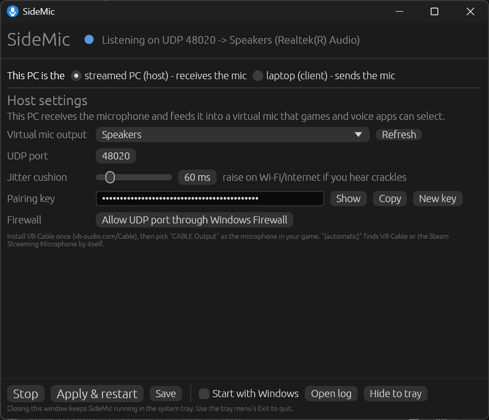

# THIS IS ENTIRELY VIBECODED FOR MYSELF

# SideMic

Use your laptop's microphone on the PC you stream from with [Sunshine](https://github.com/LizardByte/Sunshine)
(or [Apollo](https://github.com/ClassicOldSong/Apollo)) and [Moonlight](https://moonlight-stream.org/).

Moonlight and Sunshine don't carry microphone audio from the client back to the host. The forks that add it
have to patch both programs and break whenever either one updates. SideMic takes a different route: it is a
small **sidecar** that runs next to Moonlight on the laptop and next to Sunshine on the streamed PC, carries
your mic over its own encrypted UDP stream, and plays it into a virtual microphone on the host. It never
touches Moonlight or Sunshine, so their updates can't break it.



```
 Laptop (client)                                 Streamed PC (host)
 ┌──────────────────────────┐                    ┌───────────────────────────────────────┐
 │ Moonlight.exe  (video in)│ ◄───── Sunshine ── │ Sunshine / Apollo                      │
 │                          │                    │                                        │
 │ SideMic (client)         │ ── Opus/AES-GCM ─► │ SideMic (host) ─► "CABLE Input"        │
 │   real microphone ─► Opus│     UDP 48020      │                     └► "CABLE Output" = │
 └──────────────────────────┘                    │        mic that games / Discord select │
                                                 └───────────────────────────────────────┘
```

## Features

* Settings window: pick host or client, choose devices from dropdowns, copy the pairing key, one button to
  start. Lives in the system tray afterwards.
* 48 kHz mono Opus, 20 ms frames, ~40 kbps, packet-loss concealment, adjustable jitter cushion.
* AES-256-GCM with a shared pairing key and replay protection. Wrong-key packets are dropped silently.
* Client only sends while `Moonlight.exe` is running, so it can sit in the tray forever.
* Single 7 MB `sidemic.exe`, no installer, no runtime to install. Windows 10/11 x64 on both ends.

## Setup

Download `sidemic.exe` from [Releases](../../releases) onto **both** PCs (somewhere permanent, e.g.
`C:\Tools\SideMic\`). The binary is unsigned, so SmartScreen may warn the first time.

### On the streamed PC (host)

1. Install a virtual microphone once. **[VB-Cable](https://vb-audio.com/Cable/)** is the easy choice: run its
   installer as administrator and reboot if asked. You get a playback device `CABLE Input` and a microphone
   `CABLE Output`. (The *Steam Streaming Microphone* device that Sunshine's optional audio driver installs works
   too; enable it under `mmsys.cpl` > Show Disabled Devices on both the Playback and Recording tabs.)
2. Run `sidemic.exe`. Choose **streamed PC (host)**, leave the output on *(automatic)*, click
   **Allow UDP port through Windows Firewall**, tick **Start with Windows**, then **Save & start**.
3. Click **Copy** next to the pairing key. Get it to the laptop (paste it in a chat to yourself, whatever).
4. In your game / Discord / etc. pick **CABLE Output** as the microphone.

### On the laptop (client)

1. Run `sidemic.exe`. Choose **laptop (client)**, enter the host's IP (the same one Moonlight uses), paste the
   pairing key, tick **Start with Windows**, then **Save & start**.
2. That's it. The status line turns green with *connected* as soon as the host answers. From now on the mic
   flows whenever Moonlight is running; right-click the tray icon to mute.

Closing the window keeps SideMic running in the tray. Double-click the tray icon to get it back; *Exit* is in
the tray menu.

### Checking it works

* Host window/tray shows *Receiving mic from <laptop ip> (… kbps)*.
* On the host, `mmsys.cpl` > Recording > `CABLE Output` shows a moving level meter while you talk.
* Both ends write `sidemic.log` next to the exe (or in `%LOCALAPPDATA%\SideMic` if that folder is read-only).

## Settings reference

Everything the window edits lives in `sidemic.json` next to the exe. You can also drive SideMic from the
command line (`sidemic help`), which is handy for scripting or headless setups.

| key | default | meaning |
|---|---|---|
| `mode` | | `host` or `client` |
| `host` | | client: host PC address |
| `port` | `48020` | UDP port, same on both ends |
| `key` | | shared key (base64, 32 bytes). Host generates it on first run |
| `micDevice` | `""` | client: microphone name; empty = Windows default mic |
| `outputDevice` | `""` | host: playback device feeding the virtual mic; empty = auto (`CABLE Input`, then `Steam Streaming Microphone`) |
| `bitrate` | `40000` | Opus bits/s. 24000 is fine for voice, 64000 is very clean |
| `followMoonlight` | `true` | client: only send while `moonlightProcess` runs |
| `moonlightProcess` | `Moonlight` | client: process name without `.exe` |
| `jitterMs` | `60` | host: cushion against network jitter. Raise to 100-150 on Wi-Fi/Internet if you hear crackles |
| `startMuted` | `false` | client: start muted |

Command line:

```
sidemic                        open the settings window (tray stays after closing it)
sidemic --minimized            start in the tray only (what the Start-with-Windows shortcut runs)
sidemic host --console         run the host in a terminal, prints the pairing key
sidemic client --console --host <ip> --key <key>
sidemic devices                list audio devices
sidemic firewall               allow the UDP port (asks for admin)
sidemic autostart [--remove]   add/remove the Startup shortcut
```

### Running it from Sunshine instead of at startup

If you'd rather the host side only run while a stream is active, add it as a global prep command in Sunshine's
web UI (Configuration > General > Command Preparations), or per application:

* Do: `"C:\Tools\SideMic\sidemic.exe" host`
* Undo: `taskkill /IM sidemic.exe /F`

### Streaming over the Internet

Forward UDP 48020 to the host like you forward Sunshine's ports, or run both machines on the same VPN
(Tailscale, WireGuard, ZeroTier) and use the VPN address as the host. Raise the jitter cushion to ~120 ms.

## Building

Needs Rust (stable, MSVC target) plus Visual Studio Build Tools with the "Desktop development with C++"
workload, which provides the compiler, linker and CMake that the bundled libopus needs. If `cmake` is not on
your PATH, add the one that ships with Build Tools:

```
set PATH=C:\Program Files (x86)\Microsoft Visual Studio\18\BuildTools\Common7\IDE\CommonExtensions\Microsoft\CMake\CMake\bin;%PATH%
cargo build --release
```

`.cargo/config.toml` sets `CMAKE_POLICY_VERSION_MINIMUM=3.5` because the libopus bundled in `audiopus_sys`
predates CMake 4's minimum-version rule. The exe lands in `target\release\sidemic.exe`.

Crates: [cpal](https://github.com/RustAudio/cpal) (audio I/O), [opus](https://crates.io/crates/opus) (libopus),
[aes-gcm](https://crates.io/crates/aes-gcm), [egui/eframe](https://github.com/emilk/egui) (window),
[tray-icon](https://crates.io/crates/tray-icon).

## How this was made (fully vibe-coded)

Every line in this repository, this README included, was written by [Claude Code](https://claude.com/claude-code)
(Anthropic's Claude, Fable 5.1 with a short stretch on Opus 5.5) in a single conversation on 13 November 2026,
directed by [@That1N3rd](https://github.com/That1N3rd). The human never typed code; the AI never ran unsupervised.
For the curious, this is roughly how it went:

1. **The ask** was "fork Moonlight or Sunshine so my laptop mic works on the streamed PC, ideally as a plugin
   that survives updates." Claude researched the state of the art first: upstream has no mic support
   ([roadmap issue](https://github.com/LizardByte/roadmap/issues/56), an Extra-Large open item), and the
   existing forks ([moonlight-mic](https://github.com/JimothySnicket/moonlight-mic),
   [Apollo PR #1428](https://github.com/ClassicOldSong/Apollo/pull/1428)) all pin both ends to patched builds
   and are wire-incompatible with each other. Neither program has a plugin system, so "a plugin" is impossible,
   but a **sidecar** that never touches them is update-proof. That became the design.
2. **First implementation in C#**, because the machine had no C++ toolchain and Rust couldn't link. Claude
   installed the .NET 8 SDK into the user profile and built the whole thing with NAudio and a pure-C# Opus port:
   protocol, encryption, jitter buffer, tray, follow-Moonlight mode. Tested as a loopback on one machine.
3. **Rewrite in Rust** when the user asked how hard it would be (answer: a few hours). Claude installed Visual
   Studio Build Tools via winget, ported everything with cpal/libopus/aes-gcm/tray-icon, kept the wire format
   identical, and proved it by running the Rust client against the C# host and vice versa. 66 MB became 1.5 MB.
4. **GitHub.** Claude installed the GitHub CLI, assembled the repo, wrote the first release notes and shipped
   v0.1.0 while the human handled the browser login.
5. **This release.** A settings window with egui, the rename from "MicBridge" to SideMic (chosen from a list of
   name ideas Claude checked against GitHub for collisions), and dropping the C# build at the user's request.

What the AI verified: unit tests for the packet format, replay window and resamplers; host and client streaming
to each other on one machine in every combination; wrong-key rejection; follow-process start/stop; tray-only and
window launches. What it could **not** verify: the real two-machine setup with VB-Cable, and clicking through the
window by hand. Treat it as a well-tested prototype, read the code before trusting it with your voice (it is
about 2,300 lines), and open an issue if something misbehaves.

## Limitations

* Windows only for now (both ends). cpal, opus and the protocol are portable; only `win.rs` and the tray/window
  bits are Windows-specific, so a Linux/macOS client is a modest follow-up.
* One talker at a time. If two clients send, the host keeps the first until it goes quiet for a second.
* The virtual-mic device is something you install once (VB-Cable or Steam's driver); SideMic does not ship a driver.

## License

MIT, see [LICENSE](LICENSE). libopus is BSD-licensed.
